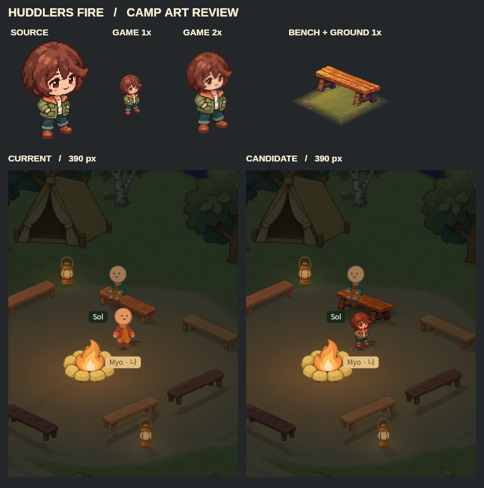

# 모닥불 옆에서의 첫 시안 · 2026-11-20

왼쪽은 현재 캠프, 오른쪽은 캐릭터·벤치·바닥 후보를 같은 조건에 놓은 화면이다. 아래 모바일 캡처는 가로 390픽셀 원본이다. PC 원본도 각각 열 수 있다.

| | 현재 | 후보 |
| --- | --- | --- |
| PC 1050×824 | [현재 캠프](review/desktop-before.png) | [새 시안](review/desktop-candidate.png) |
| 모바일 390×520 | [현재 캠프](review/mobile-before.png) | [새 시안](review/mobile-candidate.png) |

## 그림을 어떻게 바꿨는지

- **캐릭터** · 첫 생성은 상하체가 길어 제외했다. 새 텍스트에 머리와 턱 아래 길이를 따로 넣어 다시 생성했다. 두 번째 [원본](originals/camper.png)의 큰 머리를 [게임용 64×96](game/camper.png)에 맞춰 몸과 독립적으로 배치했다. 보이는 인물 높이는 약 70px, 머리는 약 34px다. 앞머리·눈·부츠 방향은 1배에서도 구분되지만 얼굴이 오른쪽을 향한 정도와 재킷의 작은 주머니는 축소 과정에서 약해졌다.
- **벤치** · [원본](originals/bench.png)에서 상판 결, 지지대, 작은 색 변화를 남겼다. 게임 좌석 좌표에 맞춰 상판 중심을 재배치했다. 한 명이 앉은 상태에서 나머지 한 자리가 보인다.
- **바닥** · [원본](originals/ground.png)의 모서리가 야간 캠프에 네모난 패치처럼 드러나 가장자리 투명도와 합성 강도를 조정했다. 기존 바닥과 자연스럽게 섞이지만 야간 화면에서는 잔디와 흙길 변화가 약하다.
- **편집 범위** · [머리](layers/head.png), [재킷](layers/jacket.png), [하체](layers/lower.png)가 같은 캔버스에 정렬된다. [레시피](recipe.json)로 재구성할 수 있다. 머리에는 얼굴·머리카락이 함께 있고 가려진 부분의 별도 작화가 없어 헤어 교체용 베이스는 후속 작업이다.

캡처는 DPR 1의 오프라인 Canvas다. 실제 기기의 WebGL·최종 조명·애니메이션은 여기서 검증하지 않았다. 외부 유료 API 호출 없이 각 원본을 별도 텍스트로 생성했다. 제공된 모델 버전 식별자는 없다. 기술 확인 후 상태는 미술 선택 대기다. [하네스 실행 안내](../../../../docs/art/scene-first-review.md)
