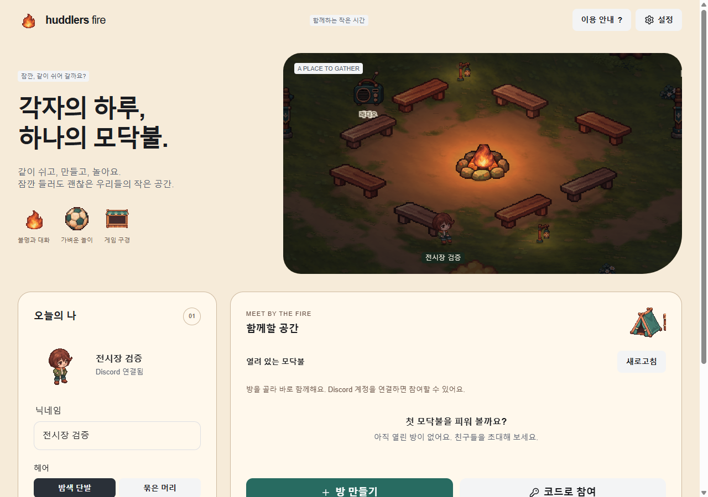
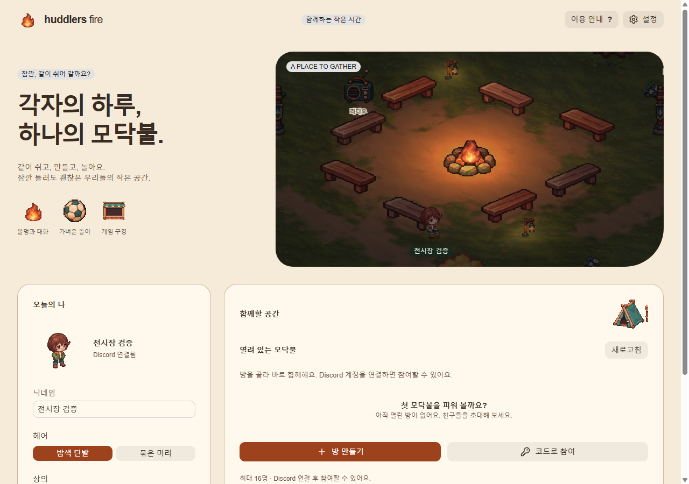
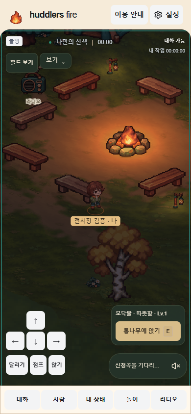
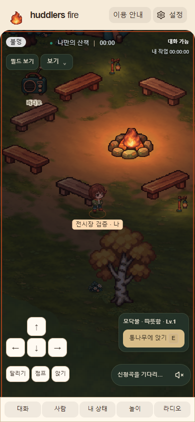
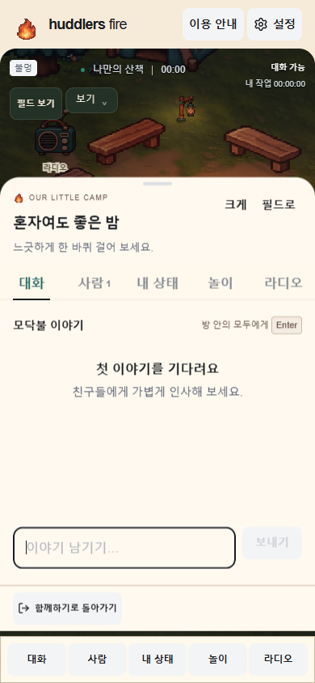
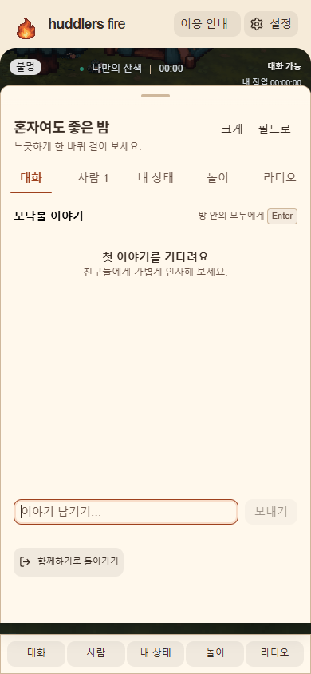
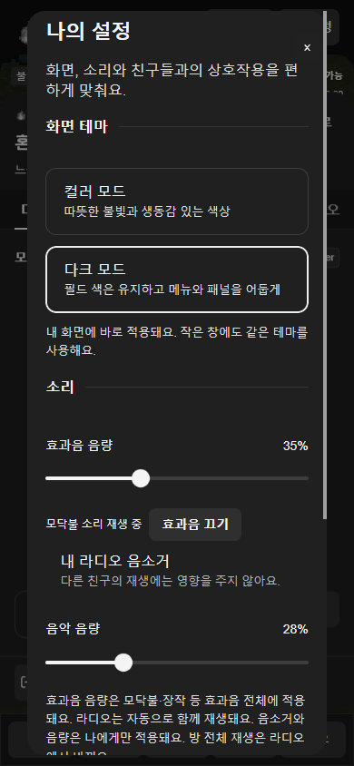
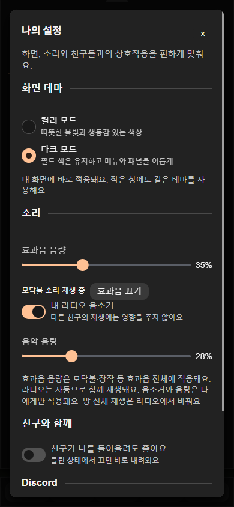

# HuddlersFire UI 전후 비교

2026-11-20에 같은 캠퍼와 지형으로 로비에 들어가 혼자 산책을 시작하고, 대화 패널과 설정을 열었다. 왼쪽은 `f69d22d`의 UI에 작업 폴더의 지형을 적용한 화면이고, 오른쪽은 Astryx 0.7.16을 적용한 로컬 빌드다. 빈 공개 방 목록, 연결된 테스트 계정, 화면 크기와 시작 테마를 맞췄다.

| 화면 | 변경 전 | Astryx 적용 후 |
| --- | --- | --- |
| PC 로비 · 1280×900 |  |  |
| 모바일 필드 · 390×844 |  |  |
| 모바일 대화 · 390×844 |  |  |
| 모바일 다크 설정 · 390×844 |  |  |

브라우저는 격리한 헤드리스 Chromium 계열 Chrome을 사용했다. 모바일은 뷰포트 에뮬레이션이며 애니메이션 재생 시점에 따라 모닥불과 캠퍼 자세가 조금씩 다를 수 있다. 입력, 패널 전환, 작은 창과 전시장 상호작용의 결과는 [검증 기록](../validation.md#astryx-ui)에 있다.
