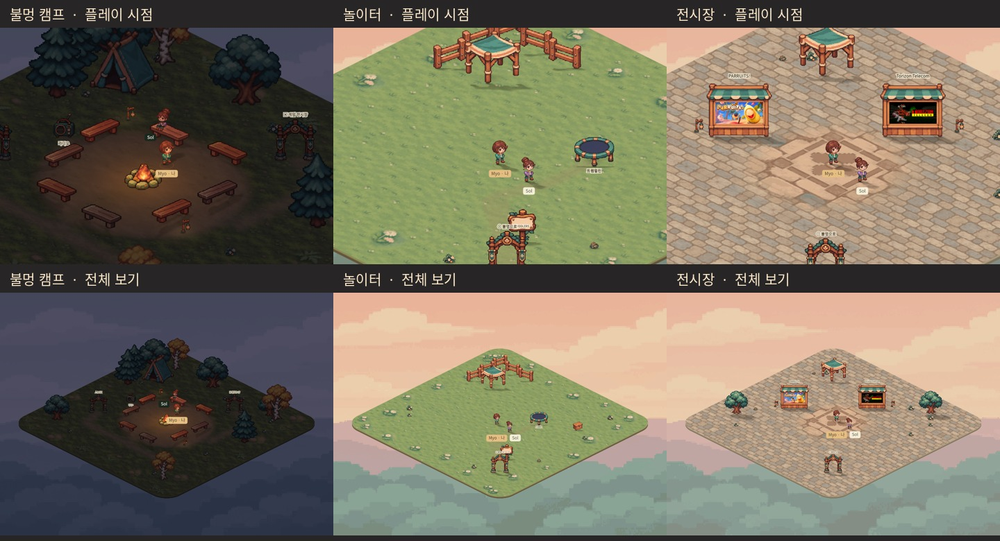

# 캠퍼 기준 그래픽 개편

사용자 요청 “일단 프로필 얼굴 교체 되는 거 지워주고 모든 그래픽들의 톤앤매너를 캐릭터 기준으로 변경해줘”와 후속 진행 확인 “엉 진행해줘”를 적용했다. 최종 미술 평가는 사용자에게 있다.

캠퍼의 적갈색 외곽선, 청록색 직물과 밝은 목재 면을 소품, 벤치, UI 포트레이트에 사용한다. 바닥 무늬는 캐릭터 발보다 작은 세부 요소로 합성하고 게임 내 이동 경로에 흙길을 맞춘다. 불꽃 여섯 프레임은 다섯 모닥불 스타일에 맞춰 조립한다. 참가자 UI는 캠퍼와 같은 헤어, 상의, 톤을 그린다.

생성 원본 여섯 장과 요청문은 `art/sprites/camper-style-release/`에 있다. Node와 Pillow를 설치한 Python으로 `python tools/build-camper-style.py`를 실행하면 배포용 시트와 프레임 정의를 재생성한다. `web/`에서 `node --import ./tests/sprite-fixture.mjs tests/render-landscapes.mjs`로 세 맵을 확인할 수 있다.

| 배포 이미지 | SHA-256 |
| --- | --- |
| `camper-style-camp-scenery.10becb8fbb0a.png` | `10becb8fbb0ae222765c17f9b943f6cc899851d961ebd981e644b117b047825e` |
| `camper-style-camp-scenery-dark.85bde86b65cb.png` | `85bde86b65cbb455c53e32bc16219ad6cf0dd3df76eb2f679a584fca4a126da5` |
| `camper-style-normal-camp-scenery.4f4e39449ba9.png` | `4f4e39449ba97cf68df066dd08406eeab9b2343995276a74bcfd89c98bb4b9ab` |
| `camper-style-camp-clearing-art.49fee2a71003.png` | `49fee2a71003e96f0e1cd4d889fd2ab4ebfea798135b72d3e57d49139e146547` |
| `camper-style-camp-clearing-art-dark.f0e3a7564455.png` | `f0e3a7564455e84aba44b7aa35a41e5b9f625dc4ad5d0afb49dcf133085b0a83` |
| `camper-style-normal-camp-clearing-art.fe01f32ee5d8.png` | `fe01f32ee5d843d6a1ffb0db4d1a1ef92cd82306a21a4860faf8e6a6be2f0a93` |
| `camper-style-effects.d3769364f5d6.png` | `d3769364f5d6ec1e3bb8e4e573b148899195af07d47bb7f6e139ba7d09959b66` |
| `camper-style-effects-dark.1a310703019d.png` | `1a310703019df953a9b9804242445ba192b99fc3ae382ac9e18c823a17f13e1d` |
| `camper-style-landscape-camp.bc2360257c1e.png` | `bc2360257c1ea905cba66190ccf04b9e71021b04513f3450b7c8d27280355169` |
| `camper-style-landscape-playground.ce00014941f2.png` | `ce00014941f2fa56891d37697be72c6aceb4abb25280914c7edb0ced3f7d7465` |
| `camper-style-landscape-showroom.72d5e3607756.png` | `72d5e3607756d65d02d2e766564a6e019fd7fd4ab06f493d21af06cd9b8fd0d8` |
| `camper-style-camp-icon.d8096d3facdf.png` | `d8096d3facdfeacbf12c2f22965c277785710a983b0a00bb603a20c94d86f104` |
