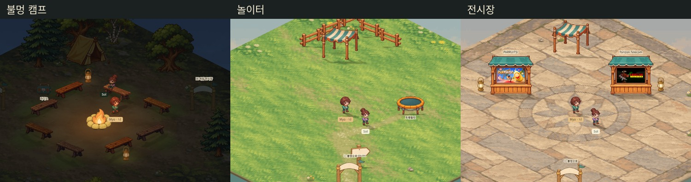

# 세 맵 배경·그림자·얼굴 변경

사용자 요청 “일단 얼굴 프로필교체되는 기능은 삭제하고 배경 그래픽도 전체 개선해줘 진행하는 김에 그림자도 적절히 자연스럽게 보이도록 수정해줘”

“일단 전체 수정 후 배포해줘”에 이은 변경 요청이다. “이거 멈춘작업 마저 재개해줘”로 같은 작업을 재개했다. 아래 파일은 이 범위로 배포하는 런타임 이미지다. 최종 미술 평가는 사용자에게 있다.

원본 다섯 장과 생성 요청은 `art/sprites/landscape-release/`에 있다. `web/`에서 `node scripts/build-landscape-art.mjs`와 `node scripts/build-camp-scenery.mjs`를 실행하면 배경과 소품을 각각 다시 만들 수 있다. `node --import ./tests/sprite-fixture.mjs tests/render-landscapes.mjs`는 세 맵의 전체 보기, 데스크톱, 모바일, 흑백 장면을 렌더링한다.

| 배포 이미지 | SHA-256 |
| --- | --- |
| `landscape-camp.b660513b72dc.png` | `b660513b72dc6e890790a221756ab23e5baaa327c77b7ec0a3a79a79e7afb362` |
| `landscape-playground.3dbcefa5e1f8.png` | `3dbcefa5e1f8430973a91326a48fddb9fbef6f2876c673bbb3d4fac9b790ffa5` |
| `landscape-showroom.f43544da62eb.png` | `f43544da62ebf1d1d9cfee3722ec00bd300c04c2052b0485643a36299e0e95f7` |
| `camp-scenery.1b6ecbbbfc19.png` | `1b6ecbbbfc19232a5216c71d19e4579728753530db11d93e70d70376f55fdf68` |
| `camp-scenery-dark.ffafc1b61dd2.png` | `ffafc1b61dd2046f3436b27126687783ee1e74f7119b2046c1630c62fb367d78` |
| `normal-camp-scenery.fc2760df91d5.png` | `fc2760df91d5149055770295b46e8a83b9c7eee1c1513ee12ff2f5494afac0a5` |
