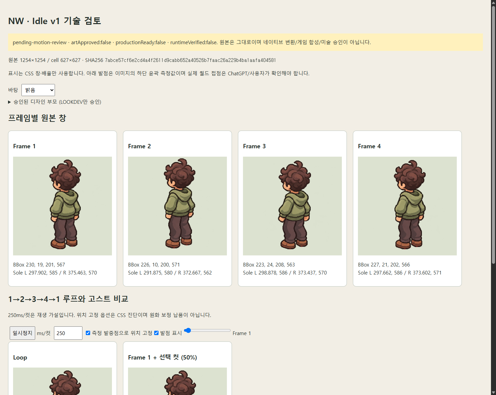

# NW Idle v1 · 기술 검토

**모션 미술 검토 대기**: decision:pending, artApproved:false, animationApproved:false, productionReady:false, runtimeVerified:false. 기술 검사는 호흡의 미술적 완성도나 동일 인물 PASS가 아니다.

- [프레임 비교·루프·고스트·발점·밝음/어두움 검토 HTML](nw-review.html): 파일을 내려받아 브라우저에서 연다. GitHub 파일 화면은 HTML을 재생하지 않는다.
- [전체 측정 JSON](nw-analysis.json), [부모 계보](lineage.json), [다음 원화 요청서](IDLE_V2_REQUEST.md).
- 원본: `art/sprites/source-registry/rounded02-idle-motion-01/original/nw-idle-4cut-v1.png` / 1254×1254 / 685555 bytes / SHA256 `7abce57cf6e2cd4a4f2611d9cabb652a40526b7faac26a229b4ba1aafa404581`.
- 부모 디자인 SHA256 `c1d4bde7cb49cdba5a5221c7d967eb475593780779122279b350d317e2e3b95a`. 기존 art-direction 게이트로 검증한 LOOKDEV 승인만 참조한다.

## 네 컷 크기와 위치

원본은 2×2이며 좌상→우상→좌하→우하 순서다. 각 셀은 **627×627**. 좌표는 셀 로컬이며 x,y는 픽셀 인덱스, bbox는 x,y,width,height다. 아래 core bbox는 분석 시 alpha≥128을 읽은 결과다. PNG 알파를 수정하거나 이진화한 것이 아니다. alpha>0의 전체 bounds는 희미한 잔여 픽셀 때문에 셀 경계까지 확장되므로 JSON의 두 bounds를 구분한다.

| 컷 | 셀 원점 | 캐릭터 core bbox | 발 하단 L | 발 하단 R | 몸 중심 proxy | 몸 중심 Δ(컷1 기준) |
| --- | --- | --- | --- | --- | --- | --- |
| 1 | 0, 0 | 230, 19, 201, 567 | 297.9, 585 | 375.5, 570 | 331.4, 315.8 | 0, 0 |
| 2 | 627, 0 | 226, 10, 200, 571 | 291.9, 580 | 372.7, 562 | 326.1, 306.6 | -5.3, -9.2 |
| 3 | 0, 627 | 223, 24, 208, 563 | 298.9, 586 | 373.4, 570 | 330.4, 321.3 | -1, 5.5 |
| 4 | 627, 627 | 227, 21, 202, 566 | 297.7, 586 | 373.6, 571 | 330.7, 317 | -0.7, 1.2 |

L/R은 화면의 두 신발 영역이지 해부학적 좌우가 아니다. 하단 22%에서 갈색 신발의 열별 분포로 분할하고, 일정 수 이상의 픽셀이 지지하는 최하단 행과 마지막 3행의 가중 x를 측정했다. 이미지상의 발밑 윤곽 proxy로 **월드 접점 보증이 아니다**. 원본과 빨간 마커를 대조해야 한다. 쿼터뷰 두 신발의 y가 다른 것은 정상일 수 있으므로 같은 y로 강제 정렬하지 않는다. 몸 중심도 bbox 높이 35–68% 영역의 알파 가중 중심이며 관절 추적은 아니다.

## 프레임별 위치 이동 가설

| 컷 | 컷1 발중점에 맞추는 CSS 이동 Δx,Δy | 양발 상대 벡터 R−L |
| --- | --- | --- |
| 1 | 0, 0 | 77.6, -15 |
| 2 | 4, 7 | 80.8, -18 |
| 3 | 1, 0 | 74.6, -16 |
| 4 | 1, -1 | 75.9, -15 |

위 이동은 **진단용 CSS 표시**이며 수정된 프레임 파일을 만들지 않았다. 양발 상대 벡터가 컷마다 다르므로 하나의 평행이동으로 두 신발의 모양·접점을 모두 완전히 고정할 수 없다. 원화의 신발 형태 변화와 측정 proxy의 불확실성을 함께 검토해야 한다.

## 픽셀 변화와 루프

픽셀 비교는 디코딩한 RGBA의 premultiplied RGB를 사용해 alpha=0의 숨은 RGB를 무시한다. 변화율 분모는 가시 영역 합집합이다. 평균 오차는 채널별 절댓값 평균(0–255), ‘유의 변화’는 네 채널 차이 합>64다. 정확히 다른 픽셀 비율은 1단계 알파/색 차이에도 올라가므로 원화 재작화 비율로 해석하지 않는다. 이동 후 수치는 측정 발 이동 주변과 원점 주변의 **근사 정수 이동 탐색** 결과이며 유일한 광학 정합 해답은 아니다.

| 전환 | 원시 변화 픽셀/가시 영역 | 원시 평균 오차 | 다음 컷을 이전 컷에 맞추는 근사 이동 | 이동 후 평균 오차 | 이동 후 유의 변화 |
| --- | --- | --- | --- | --- | --- |
| 1→2 | 103989/105281 (98.773%) | 24.985 | 3, 13 | 12.165 | 22.289% |
| 2→3 | 111582/112686 (99.02%) | 29.236 | -3, -15 | 18.352 | 31.487% |
| 3→4 | 107210/110493 (97.029%) | 14.478 | 1, 6 | 10.67 | 17.965% |
| 4→1 | 100501/104283 (96.373%) | 5.999 | -1, 1 | 5.325 | 8.732% |

**최대 원시 차이는 2→3**다. 4→1 평균 오차는 원시 5.999, 이동 후 5.325이며 다른 전환보다 작다. 따라서 끝→처음만 고치면 루프가 해결된다고 볼 수 없다. 실제 타이밍은 PNG에 없으며 HTML의 250ms/컷·1초/루프는 조절 가능한 표시 가설이다. loopVerified:false를 유지한다.

| 전환 | 이동 후 머리 영역 오차 | 몸통 영역 오차 | 다리 영역 오차 | 발 영역 오차 |
| --- | --- | --- | --- | --- |
| 1→2 | 7.668 | 15.767 | 4.929 | 23.451 |
| 2→3 | 13.036 | 26.167 | 8.412 | 25.361 |
| 3→4 | 7.521 | 12.212 | 7.047 | 19.788 |
| 4→1 | 4.354 | 6.559 | 4.041 | 6.127 |

영역은 이전 컷 bbox의 높이를 나눈 수평 밴드로, 머리/몸통/발의 정확한 의미 마스크는 아니다. 그 한계 안에서도 이동 후 발·몸통 영역에 오차가 남는다.

## 단순 상하 이동인가, 호흡인가

컷2에서 몸 중심이 올라가고 컷3에서 내려가며 컷4와 컷1이 중립 부근으로 돌아오는 상하 순서가 측정된다. 발도 함께 움직이고, 신발 간 상대 벡터·bbox·픽셀 값이 변한다. **같은 그림 한 장의 단순 상하 이동만으로 설명되는 시트는 아니다.** 위치 성분과 국소 형태/색/알파 변화가 함께 있다.

발을 고정했을 때 가슴·어깨·후드의 작은 팽창/이완으로 읽히는지, 전신 들썩임·무릎 굽힘·컷별 모핑으로 읽히는지는 ChatGPT의 미술 평가가 필요하다. Codex는 호흡 PASS를 부여하지 않았다. 원본 시트의 정지 관찰에서는 곱슬·후드·바지 주름·신발 윤곽을 컷 간 대조해야 하는 변화가 보이며, 방향별 동일 인물/의상 최종 판정도 보류한다.

## 알파와 경계

네 셀 전체: 투명 1176982, 반투명 394801, 완전 불투명 733 픽셀. JSON에 0–255 히스토그램을 포함한다. 내부에도 alpha 253 등의 거의 불투명한 픽셀이 다수 있으므로 반투명을 외곽 안티앨리어싱만으로 설명하지 않는다. 매우 희미한 픽셀은 셀 경계에 닿지만 alpha≥128의 캐릭터는 어느 셀도 잘리지 않았다. 명암 바탕에서 헤일로/윤곽을 검토하고, 이번 단계에서는 알파 정리·색 양자화·네이티브 변환을 하지 않는다.

## 위치 보정만으로 해결할 수 있는 것

- 같은 셀 크기·행우선 순서로 표시하고 공통 타이밍을 적용하는 것.
- 위 CSS 이동으로 컷 사이의 **전체 위치 이동 성분**을 겹쳐 비교하는 것. 실제 원화 수정/게임용 보정 승인과는 다르다.
- 밝음/어두움 바탕, 고스트 오버레이, 정지·스크럽으로 흔들림의 원인을 분리하는 것.

## 새 원화에서 수정·확인이 필요한 것

1. 각 방향에서 양발의 모양과 각 접점을 따로 고정한다. 위치 이동 후에도 남는 양발 상대 벡터 변화는 전체 이동 하나로 지울 수 없다.
2. 컷2↔컷3의 큰 상태 차이를 줄이고, 가슴/어깨/후드에 호흡의 주된 변화가 모이도록 원화를 검토한다. 신체 전체가 바닥에서 뜨는 결과를 피한다.
3. 곱슬 덩어리, 후드 테두리, 주머니/소매, 바지 주름·신발 바닥의 모양과 색을 추적해 우연한 모핑을 정리한다. SE는 눈·귀·입도 함께 비교하고 NW는 눈 없는 뒷사선과 머리/골반/신발 방향을 유지한다.
4. 4→1 이음새를 확인하되 1→2·2→3·3→4도 같은 리듬으로 다시 검토한다. 실제 재생 시간은 ChatGPT가 제안하고 사용자가 선택한다.
5. 알파가 내부까지 거의 불투명한 값으로 분포하는 원인을 제작 단계에서 확인한다. 이번 PNG를 임계값 처리해 고치지 않는다.

[어두운 바탕 캡처](nw-dark.png). 캡처는 검토 HTML의 화면이며 별도 스프라이트 납품이 아니다.
