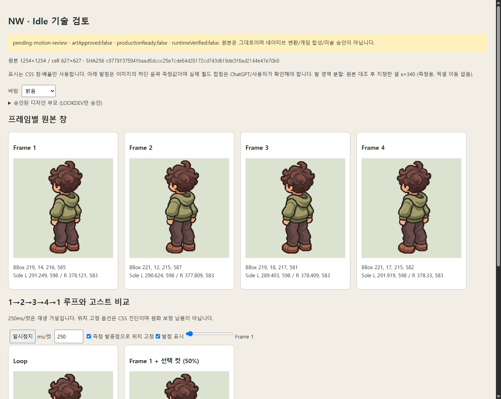

# Rounded 02 NW Idle v2 · 수신·기술 비교

**NW v2 후보만 수신했다. SE v2는 미수신이며 v1로 대체하지 않았다.** 미술 승인은 계속 `pending-motion-review`다. 디자인 부모 승인, 모션 선택, 네이티브·런타임 승인과 배포를 구분한다.

## 원본과 검토 도구

- [실제 보존 PNG](../../../art/sprites/source-registry/rounded02-idle-motion-02-nw/original/nw-idle-4cut-v2.png)
- [Manifest](../../../art/sprites/source-registry/rounded02-idle-motion-02-nw/MANIFEST.json), [SHA256SUMS](../../../art/sprites/source-registry/rounded02-idle-motion-02-nw/SHA256SUMS.txt)
- [네 컷·루프·발점·고스트·명암 HTML](nw-review.html): 단일 파일을 내려받아 브라우저에서 연다. 원본을 포함하며 별도 서버나 ZIP은 필요 없다.
- [원시 측정 JSON](nw-analysis.json), [새 모션 job 증거](evidence/), [v1 NW 리포트](../rounded02-idle-v1-20261108/NW_REPORT.md).

수신 파일: AgentHub 사용자 첨부 Image #1, `4718868ec929dc8c065e9729a580f0f9.png`, 2026-11-08. 제작 대화 URL과 실제 생성 모델 메타데이터는 제공되지 않아 모델은 `unverified/null`이다.

**1254×1254 RGBA PNG, 915,804 bytes, 2×2 / 627×627 셀**.
SHA256: `c9779f37594fbaad5dccc25e7cde64d20172cd743d619de3f6ad2144e47e70b0`.
첨부 원본·레지스트리·새 job의 source 바이트를 대조했다. 재압축·리사이즈·양자화·반전·알파 수정은 하지 않았다.

## v1 대비 측정 변화

| 항목 | NW v1 | NW v2 |
| --- | ---: | ---: |
| 셀 | 627×627 | 627×627 |
| 컷1 core bbox 크기 | 201×567 | 216×585 |
| 컷2→3 몸 중심 y 이동 | 14.729px | 3.904px |
| 왼발 하단 y 범위 | 580–586 | 598–598 |
| 오른발 하단 y 범위 | 562–571 | 583–583 |
| 4→1 원시 RGBA 평균 오차 | 5.999 | 3.331 |
| 2→3 위치 정합 후 RGBA 평균 오차 | 18.352 | 8.579 |

수치상 몸 중심의 상하 변동과 발 하단 y 변동은 줄었다. 새 시트 안에서 양발의 **이미지 y 접점 proxy가 고정**돼 있다. 다만 컷1 캐릭터 표시 크기도 달라졌으며 이를 원본 축소로 맞추지 않았다. 이 수치가 디자인·호흡 품질의 PASS를 의미하지는 않는다.

발점은 alpha≥128 영역에서 측정한 신발 하단 윤곽 proxy다. 이것은 측정용 읽기 조건이지 PNG 알파 이진화가 아니다. v1은 자동 열 분할, v2는 원본과 신발 마커를 대조한 뒤 셀 **x=340**을 양 신발 영역의 분할 열로 명시했다. 자동 추정은 v2의 붙은 윤곽에서 왼 신발 일부를 오른발로 잘못 잡았으므로 그 값을 최종 발점으로 사용하지 않았다. 이 분할은 픽셀 이동이나 월드 접점 승인이 아니다. 좌표와 원본 위 빨간 마커를 함께 확인한다.

| 컷 | Core bbox x,y,w,h | 몸 중심 proxy | 왼발 하단 x,y | 오른발 하단 x,y |
| --- | --- | --- | --- | --- |
| 1 | 219,14,216,585 | 330.039,320.387 | 291.249,598 | 378.121,583 |
| 2 | 221,12,215,587 | 327.514,318.622 | 290.624,598 | 377.809,583 |
| 3 | 219,18,217,581 | 329.775,322.526 | 289.403,598 | 378.409,583 |
| 4 | 221,17,215,582 | 330.552,321.384 | 291.919,598 | 378.330,583 |

| 전환 | 원시 RGBA 평균 오차 | 위치 정합 후 평균 오차 | 정합 후 유의 변화/가시 합집합 |
| --- | ---: | ---: | ---: |
| 1→2 | 10.722 | 8.920 | 15.591% |
| 2→3 | 12.240 | 8.579 | 14.470% |
| 3→4 | 3.757 | 3.668 | 5.230% |
| 4→1 | 3.331 | 3.331 | 4.311% |

오차는 decoded premultiplied RGBA의 평균 절댓값(0–255), 유의 변화는 채널 차이 합>64다. 완전 투명의 숨은 RGB는 무시한다. 단순 위치 이동으로 모든 차이가 없어지지는 않으며, 몸통·헤어·옷·신발 영역의 국소 변화가 남는다. 1→2와 2→3이 3→4·4→1보다 크므로 같은 250ms/컷이 가장 자연스러운지는 미술 검토가 필요하다. 250ms는 미확정 재생 가설이다.

## 남은 미술 검토

1. 발이 고정된 상태에서 상체 변화가 호흡으로 읽히는지, 기울임·옷 모핑으로 읽히는지 실제 루프로 평가한다.
2. 곱슬 덩어리·후드 테두리·소매·주름·신발 형태가 동일 캐릭터로 유지되는지 승인된 디자인 부모와 대조한다.
3. 왼 신발의 x proxy는 약 2.5px 범위로 변하고 신발 간 상대 벡터도 완전히 같지는 않다. 고정된 y만으로 신발 일관성 PASS를 주지 않는다.
4. 반투명은 외곽뿐 아니라 내부의 거의 불투명한 alpha에도 넓게 분포한다. 셀 경계에는 희미한 픽셀이 있지만 core 캐릭터는 잘리지 않는다. 원본을 자동 정리하지 않고 밝음/어두움에서 평가한다.
5. ChatGPT가 NW v2의 미술 평가를 제시하고 사용자가 개별 선택한다. SE v2는 별도 원본으로 받는다.

## 실제 job과 재현

새 job: `art/sprites/runs/motion-nw-rounded02-idle-v2-20261108/job.json`.
부모: `lookdev-nw-rounded02-rev2-approved-20261108`, SHA256 `c1d4bde7cb49cdba5a5221c7d967eb475593780779122279b350d317e2e3b95a`. 기존 부모·v1 원본·리뷰는 수정하지 않았다.

부모가 없는 새 clone에서는 먼저 `node tools/restore-rounded02-idle-review.mjs`로 저장된 기존 부모 증거를 검증·복원한다. 이미 있는 job은 덮어쓰지 않는다. 그다음 새 이름으로 prepare → canonical PNG intake → inspect를 실행한다. 발점 재현 옵션:

```powershell
node tools/motion-lookdev.mjs inspect --job art/sprites/runs/motion-nw-rounded02-idle-v2-20261108/job.json --foot-split 340
```

`decision:pending`, `artApproved:false`, `animationApproved:false`, `frameCellsVerified:false`, `loopVerified:false`, `productionReady:false`, `runtimeVerified:false`를 유지한다. 64×96 변환·네이티브 제작·게임 교체·배포는 하지 않았다. [실행 검증](VALIDATION.md)을 따른다.



[어두운 바탕 검토 화면](nw-dark.png). 이 PNG는 HTML 검토 화면의 캡처이며 납품용 프레임 이미지가 아니다.
