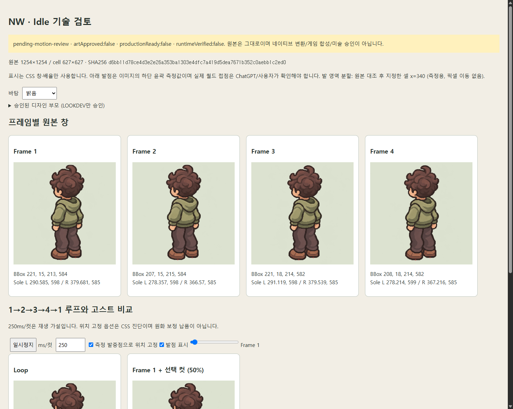

# NW Idle 추가 후보 · 수신 기록 03

**`v3/revision:3`은 수신 순서를 위한 기술 식별명이다. 사용자가 공식 이름이나 최종 선택을 확정한 것은 아니다.** 이번 이미지도 `pending-motion-review`로 보존했다. 이전 NW v2를 교체하지 않았다. SE 신규 원본은 없다.

## 원본과 검토 자료

- [원본 PNG](../../../art/sprites/source-registry/rounded02-idle-motion-03-nw/original/nw-idle-4cut-v3.png), [manifest](../../../art/sprites/source-registry/rounded02-idle-motion-03-nw/MANIFEST.json).
- [네 컷·루프·위치 고정·고스트 HTML](nw-review.html): 내려받아 브라우저에서 연다. 원본 PNG를 포함한 독립 파일이며 ZIP/별도 서버가 필요 없다.
- [전체 측정 JSON](nw-analysis.json), [독립 motion job 증거](evidence/), [이전 NW v2 비교](../rounded02-idle-v2-nw-20261108/README.md).

사용자 첨부: AgentHub Image #1, `6a8e6f67a9dff7c7e61c56a959521b47.png`, 2026-11-08. 제작 대화 URL·실제 모델 메타데이터는 미제공으로 `unverified/null`이다.

PNG **1254×1254**, **976,617 bytes**, 2×2, 셀 **627×627**.
SHA256 **`d6bb11d78ce4d3e2e26a353ba1303e4dfc7a419d5dea7671b352c0aebb1c2ed0`**.
원본은 변환 없이 보존했다. PNG 디코딩·알파·네 컷 기하 검사상 core 캐릭터 잘림은 없다. 희미한 alpha의 셀 경계 잔점과 내부 반투명은 JSON/명암 바탕에서 확인한다.

## 핵심: 오른쪽 열의 좌우 위치 차이

**2번·4번 컷의 캐릭터와 양발 전체가 1번 컷보다 왼쪽으로 약 12–14px 이동한다.** 몸 중심 x와 양발 x가 함께 변해, 국소 호흡 변화 외에 전체 평행이동 성분이 있다. 원래 1→2→3→4→1 표시에서는 좌우로 번갈아 이동하므로 이 정렬을 우선 검토해야 한다.

| 항목 | 이전 NW v2 | 이번 후보 |
| --- | ---: | ---: |
| 네 컷 몸 중심 x 범위 폭 | 3.038px | **14.796px** |
| 컷2의 몸 중심 x 변화 (컷1 기준) | −2.525px | **−14.013px** |
| 컷4의 몸 중심 x 변화 (컷1 기준) | +0.513px | **−11.999px** |
| 컷2→3 몸 중심 y 이동 | 3.904px | 2.107px |
| 왼발 하단 y 범위 | 598–598 | 598–599 |
| 오른발 하단 y 범위 | 583–583 | 585–585 |
| 4→1 원시 RGBA 평균 오차 | 3.331 | 20.282 |
| 4→1 위치 정합 후 평균 오차 | 3.331 | 3.746 |

상하 변동은 작아졌지만 좌우 등록 위치는 더 달라졌다. 따라서 일괄적인 ‘v2보다 개선’이나 ‘호흡 PASS’ 판정을 내리지 않는다. 정렬 후 오차가 크게 줄어드는 것은 전체 이동 성분의 근거이며, 자연스러운 호흡의 증명이 아니다.

## 프레임 좌표와 진단용 이동

좌표는 각 셀 로컬 픽셀 인덱스다. bbox는 x,y,width,height, 몸 중심은 bbox 높이 35–68%의 알파 가중 중심 proxy다. 발은 alpha≥128 신발 하단 윤곽의 이미지 proxy이며 해부학적/월드 접점이 아니다. **측정 영역 분할 열 x=340**을 사용하고 마커를 원본과 대조했다. PNG 알파·위치는 변경하지 않았다.

| 컷 | Core bbox | 몸 중심 x,y | 왼발 하단 x,y | 오른발 하단 x,y | 컷1 발중점에 맞추는 CSS 이동 |
| --- | --- | --- | --- | --- | --- |
| 1 | 221,15,213,584 | 330.379,320.953 | 290.585,598 | 379.681,585 | 0,0 |
| 2 | 207,15,215,584 | 316.366,319.861 | 278.357,598 | 366.570,585 | **+13,0** |
| 3 | 221,18,214,582 | 331.162,321.968 | 291.119,598 | 379.539,585 | 0,0 |
| 4 | 208,18,214,582 | 318.380,322.330 | 278.214,599 | 367.216,585 | **+12,0** |

HTML의 ‘측정 발중점으로 위치 고정’을 켜면 위 평행이동을 CSS로만 적용해 비교할 수 있다. 원본을 자르거나 옮긴 새 스프라이트 파일은 만들지 않았다. 이것은 기술적 원인 분리이며 게임용 보정 납품/설치 승인이 아니다.

| 전환 | 원시 RGBA 평균 오차 | 근사 정합 이동 B→A | 정합 후 평균 오차 | 정합 후 유의 변화 |
| --- | ---: | --- | ---: | ---: |
| 1→2 | 22.857 | +13,+1 | 5.262 | 8.504% |
| 2→3 | 21.278 | −14,−3 | 4.581 | 7.147% |
| 3→4 | 19.175 | +13,0 | 2.495 | 3.119% |
| 4→1 | 20.282 | −12,+1 | 3.746 | 5.331% |

오차는 decoded premultiplied RGBA의 채널별 절댓값 평균(0–255), 유의 변화는 채널 차이 합>64/가시 합집합이다. alpha=0의 숨은 RGB는 무시한다. 탐색은 근사 정수 이동이며 의미 영역/자연스러움 점수는 아니다. 재생 속도 250ms/컷도 미확정 가설이다.

## 다음 수정·평가 포인트

1. **동일 셀 로컬 기준으로 2번·4번의 캐릭터 전체 x 위치를 우선 확인한다.** 진단상 +13px/+12px 이동이지만 최종 원화 배치값은 원본과 접점을 검토해 결정한다. 이번 PNG를 수정·재저장하지 않고 새 원본으로 받는다.
2. 위치 성분을 제거한 루프에서 머리·후드·소매·바지·신발의 남은 변화가 호흡으로 자연스럽게 읽히는지 ChatGPT가 평가한다.
3. 상하 변동 수치만 줄이는 것을 목표로 삼지 않는다. 발의 x/y 접지와 캐릭터 일관성, 같은 재생 리듬을 함께 평가한다.
4. 사용자 선택 전에는 이전 v2와 이번 후보 모두 pending을 유지한다. Codex는 어느 후보가 더 매력적인지 또는 최종 모션 PASS인지 정하지 않았다.

## 재현·검증 경계

새 job: `art/sprites/runs/motion-nw-rounded02-idle-v3-20261108/job.json`.
부모는 기존 승인 NW lookdev `c1d4…`다. `prepare → intake → inspect --foot-split 340`으로 독립 등록했다. `decision:pending`, `artApproved:false`, `animationApproved:false`, `productionReady:false`, `runtimeVerified:false`다.

- 레지스트리 회귀 **11/11**, 모션·측정·실제 계보 회귀 **14/14** PASS.
- 임시 headless desktop/mobile: 원본 이미지 로딩·네 컷 한 줄 비교·4→1 재생·위치 고정·명암 바탕·overflow/JS 오류 검사 PASS.
- 기존 원본·후보·정책·런타임 보호 파일 **164개**의 raw SHA256 유지.
- 이번 변경은 데이터·검토 자료·증거 텍스트 LF 규칙뿐이다. 하네스/앱 실행 코드를 수정하지 않아 전체 게임 회귀·빌드·런타임 렌더를 로컬에서 반복하지 않았다. 이전 321개 전체 회귀 결과를 이번 실행으로 표시하지 않는다. GitHub CI는 별도로 확인한다.
- 네이티브 64×96 변환·알파 이진화·색 양자화·반전·게임 교체·배포는 하지 않았다.

[어두운 바탕 캡처](nw-dark.png). 검토 HTML의 화면이며 게임용 프레임 이미지가 아니다.
