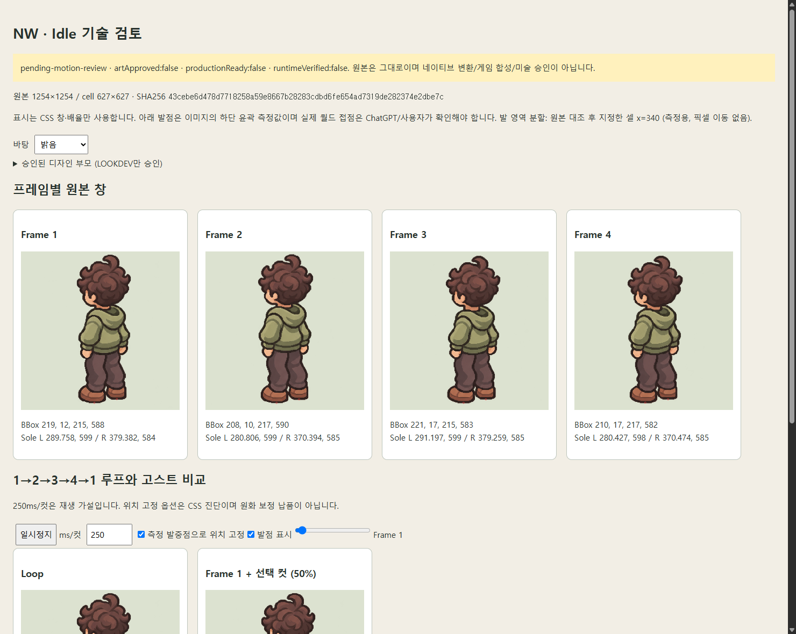

# NW Idle 추가 후보 · 수신 기록 04

`v4/revision:4`는 **수신 순서의 기술 식별명**이다. 사용자 최종 이름·미술 선택·모션 승인이 아니다. 기존 후보를 모두 보존하고 이번 NW 한 장을 독립 등록했다. SE 신규 원본은 없다.

## 원본·검토 자료

- [원본 PNG](../../../art/sprites/source-registry/rounded02-idle-motion-04-nw/original/nw-idle-4cut-v4.png), [manifest](../../../art/sprites/source-registry/rounded02-idle-motion-04-nw/MANIFEST.json).
- [네 컷·루프·고스트·명암 HTML](nw-review.html): 내려받아 브라우저에서 연다. ‘발중점 위치 고정’은 원본을 바꾸지 않는 CSS 진단이다.
- [전체 측정 JSON](nw-analysis.json), [독립 job 증거](evidence/), [이전 후보 03 비교](../rounded02-idle-v3-nw-20261108/README.md).

AgentHub 사용자 첨부 Image #1: `3cb7e21cdc8c6a0f30577354a7067896.png`, 2026-11-08. 실제 생성 모델·제작 대화 URL은 미제공으로 `unverified/null`이다.

**1254×1254 RGBA PNG, 869,226 bytes, 2×2 / 627×627 셀**.
SHA256: **`43cebe6d478d7718258a59e8667b28283cdbd6fe654ad7319de282374e2dbe7c`**.
원본은 무손실 보존했고 실제 디코딩과 레지스트리·job 수신 해시를 대조했다.

## 이전 가로 정렬 문제는 남아 있음

2번·4번 컷에서 **몸과 양발이 함께 왼쪽으로 이동하는 성분**이 계속 보인다. 발중점 기준 이동은 약 −9px이며 몸 중심은 −15.2px/−11.7px다. 전체 이동과 국소 형태 변화가 함께 있어 두 측정값이 완전히 같지는 않다. 수치는 모두 원본 셀 기준이다.

| 기술 항목 | 후보 03 | 이번 후보 04 |
| --- | ---: | ---: |
| 컷2 몸 중심 x 변화 (컷1 기준) | −14.013px | **−15.180px** |
| 컷4 몸 중심 x 변화 (컷1 기준) | −11.999px | **−11.661px** |
| 네 컷 몸 중심 x 범위 폭 | 14.796px | 15.850px |
| 컷2→3 몸 중심 y 이동 | 2.107px | **5.154px** |
| 왼발 하단 y 범위 | 598–599 | 598–599 |
| 오른발 하단 y 범위 | 585–585 | 584–585 |
| 4→1 원시 RGBA 평균 오차 | 20.282 | 25.162 |
| 4→1 정합 후 평균 오차 | 3.746 | 7.222 |

**정렬이 해결됐거나 전반적으로 개선됐다고 판정하지 않는다.** y 접점은 작은 범위에 있지만 x 접점과 상체 이동이 남는다. 호흡으로 자연스럽게 읽히는지와 캐릭터 일관성은 ChatGPT 미술 검토가 필요하다.

## 프레임별 측정

좌표는 셀 로컬 픽셀 인덱스, bbox는 x,y,width,height다. core는 분석 시 alpha≥128을 읽은 영역이다. 발은 신발 하단 윤곽 proxy로 실제 월드 접점/관절 추적이 아니다. 앞선 NW v2·후보 03과 같은 **분할 열 x=340**을 쓰고 빨간 마커를 원본과 대조했다. PNG 알파나 위치를 바꾸지 않았다.

| 컷 | Core bbox | 몸 중심 x,y | 왼발 하단 x,y | 오른발 하단 x,y | 컷1 발중점에 맞추는 CSS 이동 |
| --- | --- | --- | --- | --- | --- |
| 1 | 219,12,215,588 | 329.937,320.292 | 289.758,599 | 379.382,584 | 0,0 |
| 2 | 208,10,217,590 | 314.757,317.890 | 280.806,599 | 370.394,585 | **+9,0** |
| 3 | 221,17,215,583 | 330.607,323.044 | 291.197,599 | 379.259,585 | −1,0 |
| 4 | 210,17,217,582 | 318.276,321.862 | 280.427,598 | 370.474,585 | **+9,0** |

| 전환 | 원시 RGBA 평균 오차 | 근사 정합 이동 B→A | 정합 후 평균 오차 | 정합 후 유의 변화 |
| --- | ---: | --- | ---: | ---: |
| 1→2 | 28.609 | +12,+4 | 11.109 | 18.512% |
| 2→3 | 31.002 | −13,−7 | 12.427 | 20.093% |
| 3→4 | 25.892 | +10,0 | 6.596 | 9.875% |
| 4→1 | 25.162 | −10,+1 | 7.222 | 11.575% |

오차는 decoded premultiplied RGBA의 평균 절댓값(0–255)이다. 유의 변화는 채널 차이 합>64/가시 합집합이며 미술 점수가 아니다. ‘발중점 고정’과 ‘픽셀 오차의 근사 정합’은 서로 다른 진단이다. 정합 후에도 차이가 남으며, 이를 보정된 납품 프레임이나 자연스러운 루프 PASS로 취급하지 않는다. 250ms/컷은 조절 가능한 미확정 재생 가설이다.

## 다음 검토 제안

1. 새 원화의 동일 셀 좌표에서 **양 신발의 x/y 접점**을 먼저 고정한다. 같은 y만 유지하는 것으로는 좌우 이동을 해결할 수 없다.
2. 반복적인 전체 시트 재생성에서 정렬과 형태가 함께 바뀌고 있다. 다음에는 선호하는 기준 한 컷과 발 좌표가 고정된 제작 템플릿을 함께 사용해 ChatGPT에서 원화를 수정하는 방식을 권장한다. 이번 원본을 Codex가 이동·재저장하지 않았다.
3. 위치 성분을 분리한 HTML 루프에서 머리·후드·팔·주름·신발 변화가 호흡으로 읽히는지 ChatGPT가 평가한다. 기술 오차를 줄이는 것만으로 미술 승인을 대체하지 않는다.
4. 사용자 개별 선택 전까지 모든 모션 후보를 pending으로 유지한다. Codex는 이번 후보나 이전 후보 중 최종 디자인을 선택하지 않았다.

## 재현·검증

독립 job: `art/sprites/runs/motion-nw-rounded02-idle-v4-20261108/job.json`.
기존 승인 NW lookdev `c1d4…`를 부모로 검증하고 `prepare → intake → inspect --foot-split 340`을 실행했다.

- 레지스트리 회귀 **11/11**, 모션·측정·실제 계보 회귀 **14/14** PASS.
- 임시 headless desktop/mobile의 원본 이미지 로딩·네 컷 가로 배치·4→1 재생·명암/고스트/발중점 고정·overflow/JS 오류 검사 PASS.
- 기존 보호 원본·후보·정책·런타임 164개 해시 유지. 직전 v2/후보 03의 원본·보고서도 변경하지 않았다.
- 이번 변경은 새 원본·metadata·검토 문서/화면·증거 LF 규칙뿐이다. 하네스/앱 코드를 바꾸지 않아 전체 회귀·빌드를 로컬에서 반복하지 않았다. GitHub CI는 별도로 확인한다.

`decision:pending`, `artApproved:false`, `animationApproved:false`, `frameCellsVerified:false`, `loopVerified:false`, `productionReady:false`, `runtimeVerified:false`다. 네이티브 64×96 변환·알파 이진화·색 양자화·반전·게임 교체·배포는 하지 않았다.

[어두운 바탕 검토 화면](nw-dark.png). 검토 HTML 캡처이며 게임용 프레임 PNG가 아니다.
